<div align="center" markdown>

# Data-Free Metrics Don't Work: </br> The Missing Invariance Under Functionally Preserving Reparameterisations

[Gabryel Mason-Williams](https://gmw99.github.io/ "Personal Website")* [Israel Mason-Williams](https://ifmw01.github.io/ "Personal Website")* [Fredrik Dahlqvist](https://fdahlqvist.github.io/ "Personal Website")

\* Denotes Equal Contribution.

[![Openreview](https://img.shields.io/badge/OpenReview-8c1b13?logo=data:image/svg+xml;base64,PD94bWwgdmVyc2lvbj0iMS4wIiBlbmNvZGluZz0iVVRGLTgiPz4KPCFET0NUWVBFIHN2ZyBQVUJMSUMgIi0vL1czQy8vRFREIFNWRyAxLjEvL0VOIiAiaHR0cDovL3d3dy53My5vcmcvR3JhcGhpY3MvU1ZHLzEuMS9EVEQvc3ZnMTEuZHRkIj4KPHN2ZyB4bWxucz0iaHR0cDovL3d3dy53My5vcmcvMjAwMC9zdmciIHN0eWxlPSJiYWNrZ3JvdW5kOiB0cmFuc3BhcmVudDsgYmFja2dyb3VuZC1jb2xvcjogdHJhbnNwYXJlbnQ7IGNvbG9yLXNjaGVtZTogbGlnaHQgZGFyazsiIHhtbG5zOnhsaW5rPSJodHRwOi8vd3d3LnczLm9yZy8xOTk5L3hsaW5rIiB2ZXJzaW9uPSIxLjEiIHdpZHRoPSIyNHB4IiBoZWlnaHQ9IjMycHgiIHZpZXdCb3g9IjAgMCAyNCAzMiI+PGRlZnMvPjxnPjxnIGRhdGEtY2VsbC1pZD0iMCI+PGcgZGF0YS1jZWxsLWlkPSIxIj48ZyBkYXRhLWNlbGwtaWQ9ImxnTkdaMVBsbWZVR1F3dmxucXdPLTEiPjxnPjxwYXRoIGQ9Ik0gMSAxIEwgMTYuNzEgMSBMIDIzIDcgTCAyMyAzMSBMIDEgMzEgWiIgZmlsbD0ibm9uZSIgc3Ryb2tlPSIjMDAwMDAwIiBzdHJva2Utd2lkdGg9IjIiIHN0cm9rZS1taXRlcmxpbWl0PSIxMCIgcG9pbnRlci1ldmVudHM9ImFsbCIgc3R5bGU9InN0cm9rZTogbGlnaHQtZGFyayhyZ2IoMCwgMCwgMCksIHJnYigyMzcsIDIzNywgMjM3KSk7Ii8+PHBhdGggZD0iTSAxNi43MSAxIEwgMTYuNzEgNyBMIDIzIDciIGZpbGw9Im5vbmUiIHN0cm9rZT0iIzAwMDAwMCIgc3Ryb2tlLXdpZHRoPSIyIiBzdHJva2UtbWl0ZXJsaW1pdD0iMTAiIHBvaW50ZXItZXZlbnRzPSJhbGwiIHN0eWxlPSJzdHJva2U6IGxpZ2h0LWRhcmsocmdiKDAsIDAsIDApLCByZ2IoMjM3LCAyMzcsIDIzNykpOyIvPjwvZz48L2c+PC9nPjwvZz48L2c+PC9zdmc+&labelColor=555
)](https://openreview.net/forum?id=PQie2dx3oX "OpenReview Link") 
[](https://colab.research.google.com/github/GMW99/data-free-metrics-dont-work/blob/notebooks/ "Colab Link")

<div class="abstract" markdown>
=== ":microscope: Technical Abstract"

    Data-free methods for analysing and understanding the layers of neural networks offer many metrics for quantifying notions of strong' versus weak' layers, with the promise of increased interpretability. In particular, random matrix theory (RMT) offers data-free metrics that claim predictive power over the quality of pre-trained models at a layerwise precision and the ability to identify model pathologies, indicating a unique relationship with generalisation. As a result, metrics from RMT are championed for pre-training optimisation strategies and post-training compression. We establish that RMT-based metrics are unrelated to performance or training by showing that functionally indistinguishable reparametrisations of a pre-trained model can have arbitrary metrics. We show this across a range of architectures and scales. To create functionally indistinguishable reparametrisations, we exploit the well-established phenomenon of criticality: some layers can be re-initialised or re-randomised without affecting the functional behaviour of the model -- they are called robust -- while others cannot -- they are called critical. Re-initialising or re-randomising robust layers provides functionally indistinguishable reparametrisations for which RMT-based metrics are arbitrary. Moreover, we show that relationships between metrics offered by RMT are spuriously related to generalisation. We conclude by showing that if many pre-trained models have data-free metrics in a `good' range, it is, in part, dependent on model initialisation.

=== ":light_bulb: Lay Summary"

    **What did we look at?** Data-free metrics analyse the weight properties of neural network layers and aim to predict model performance and identify issues within models. We explore whether these metrics actually do this. 
    
    **What did we discover?** We empirically showed, by performing systematic interventions, that popular data-free metrics *are not* causally related to model performance and are therefore uninformative red herrings for understanding AI.
    
    **Why does this matter?** By showing exactly why these metrics are not informative or useful for understanding AI, we point the community toward a new direction for understanding neural networks.
</div>
</div>

## Introduction

Data-free metrics have been offered as an effective mechanism for quantifying how well trained layers are within neural networks. One such metric, Alpha (α) is believe to have a special relationship with predicting quality of trained neural networks across scales. We test if data-free metrics have the following properties.

1. Invariance under re-initialisation and re-randomisation, particularly for robust layers,
2. Ability distinguish critical from robust layers,
3. Ability to predict the performance difference between re-initialisation and re-randomisation.

**We find that $\alpha$ and no other surveyed data-free metric has these properties.**

## Background

### Alpha Transitions in Neural Networks

The figure below highlights how data-free metrics analysis neural network layers, which is typically done via the singular values or eigenvalues. Furthermore, it shows what typically happens to the eigenvalues during training.

<figure markdown >
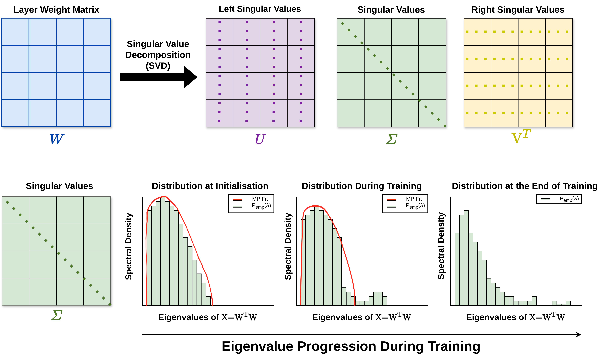
    <figcaption>Data-Free Analysis.</figcaption>
</figure>

The change in the eigenvalues has lead to creation of a set of Power Norm Metrics:

* Alpha ($\alpha$): $\rho(\lambda)\sim \lambda^\alpha$ 
* $\alpha$ Weighted: $\alpha\lambda_{\mathrm{max}}$
* $\alpha$-norm: $\sum^{n}_{i=1}\lambda_i^\alpha$
* Log-$\alpha$-norm: $\ln\left(\sum^{n}_{i=1}\lambda_i^\alpha\right)$

The primary metric is $\alpha$, where values $2\leq\alpha\leq 6$ are considered optimal and indicate well trainedness and:

* $\alpha < 2$ indicates overfitting layers.
* $\alpha > 6$ indicates underfitting layers.


### Robust and Critical Layers
* Robust Layers: Layers of a trained neural network which when re-initialised **OR** re-randomised preserve performance of the original network.
* Critical Layers: Layers of a trained neural network which when re-initialised **OR** re-randomised destroy performance of the original network.


<figure markdown >
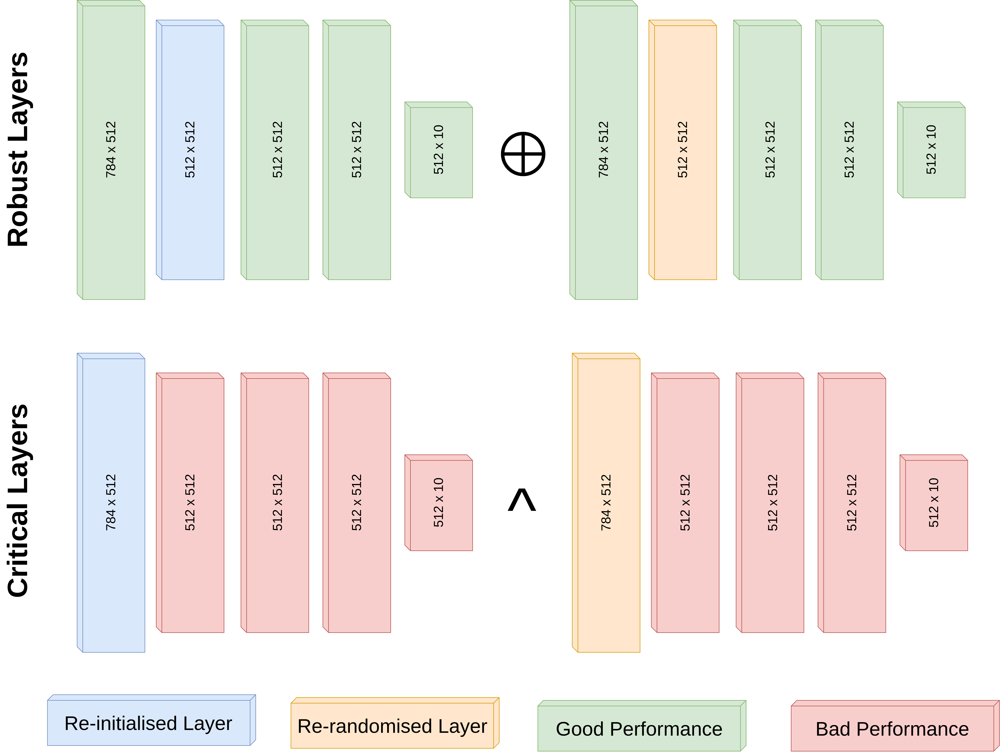
    <figcaption>Robust and crital layers.</figcaption>
</figure>


<br clear="left">

### Exact Reparametrisation Invariance and Data-Free Metrics

We utilise scale factor reparametrisation invariance, $(bW_1, b^{-1}W_2), b> 0$, see Figure below, to immediately prove that:

* Nuclear and Log-Nuclear norm: $\sum^{n}_{i=1}\sqrt{\lambda_i},\  \ln\left(\sum^{n}_{i=1}\sqrt{\lambda_i}\right)$
* Frobenius and Log-Frobenius norm: $\sum^{n}_{i=1}\lambda_i,\ \ln\left(\sum^{n}_{i=1}\lambda_i\right)$
* Spectral and Log-Spectral norm: $\lambda_{\mathrm{max}},\  \ln( \lambda_{\mathrm{max}})$   

are not causal to generalisation, as a layers value can be arbitrarily changed and the function of the model is preserved. 

<figure markdown >
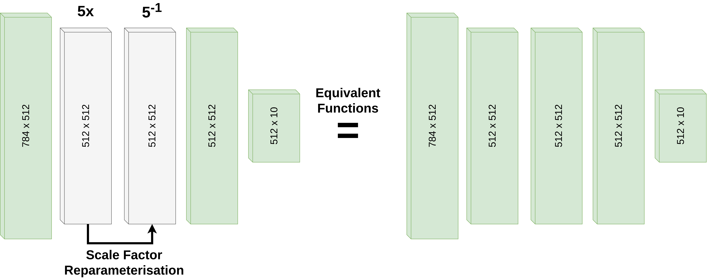
    <figcaption>Exact Reparametrisation Invariance.</figcaption>
</figure>


## Results

### Re-initialisation and Re-randomisation

The section shows that there is no correlation between a layers $\alpha$ metric and the corresponding accuracy of a model regardless of model size, after re-initialisation and re-randomisation. 

=== ":eight: MNIST Scale"


    <figure>
    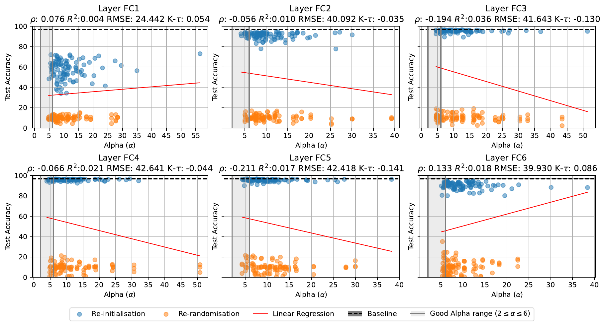
        <figcaption>Re-initialisation and re-randomisation test accuracy vs Alpha ($\alpha$).</figcaption>
    </figure>

=== ":eye: ImageNet Scale"

    <figure>
    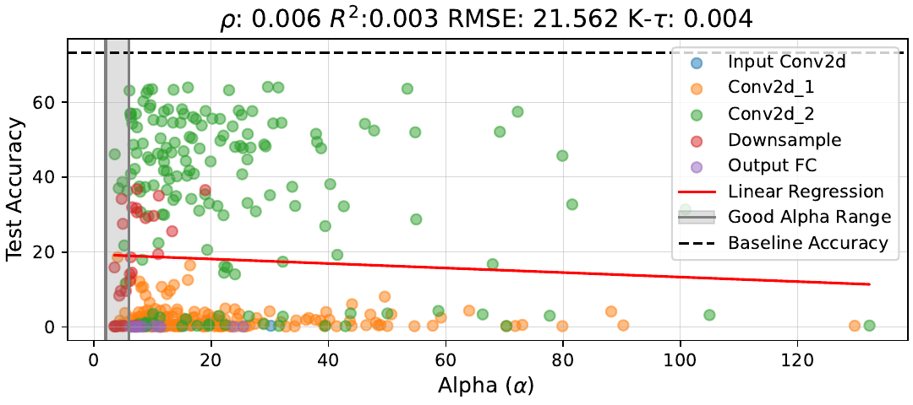
        <figcaption>ResNet34 layer re-randomisation test accuracy vs Alpha ($\alpha$).</figcaption>
    </figure>

    <figure>
    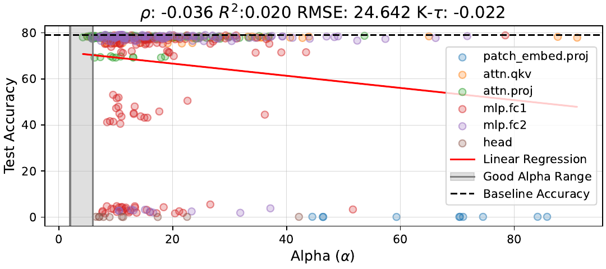
    <figcaption>ViT-base layer re-randomisation test accuracy vs Alpha ($\alpha$).</figcaption>
    </figure>

=== ":open_book: Large Language Models"

    <figure>
    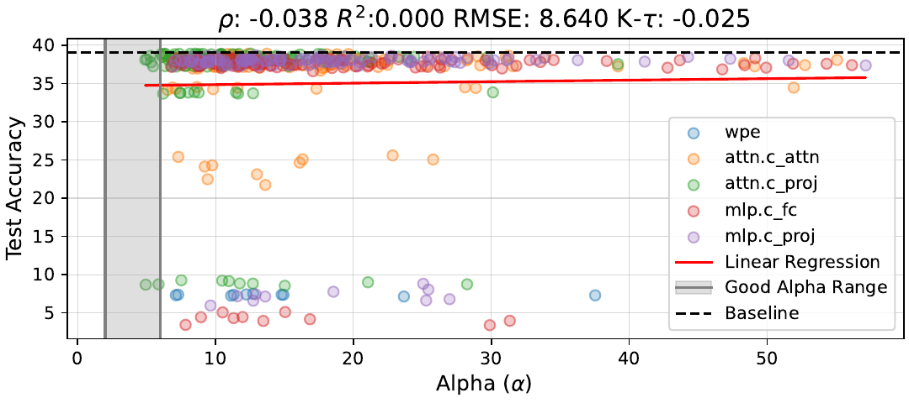
    <figcaption>GPT2 layer re-randomisation test accuracy vs Alpha ($\alpha$).</figcaption>
    </figure>

    <figure>
    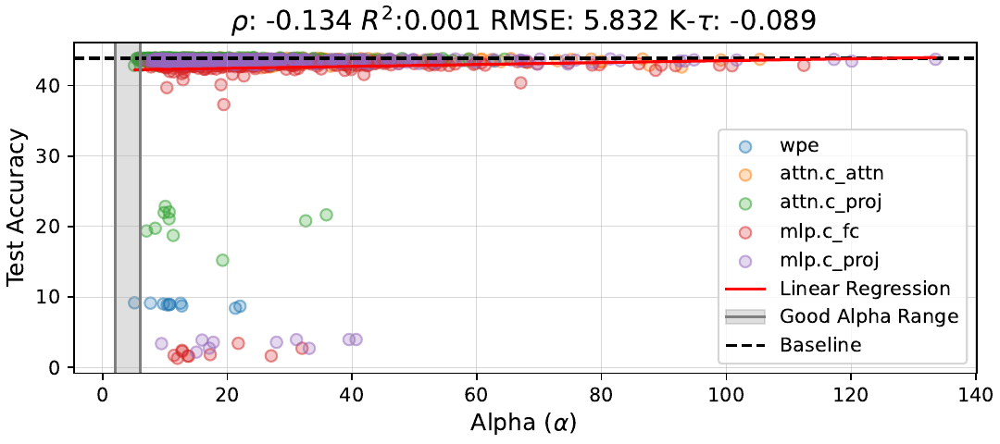
    <figcaption>GPT2-Large layer re-randomisation test accuracy vs Alpha ($\alpha$).</figcaption>
    </figure>


### The Impact of Initialisation on Alpha

We construct a family of initialisations that interpolate the max-normalised singular values $\Sigma_\lambda$ between  $\Sigma_{\lambda=1}$ and
two natural endpoints: **$I$** (which corresponds to $\lambda=0, \alpha\to \infty$), and the rank 1 spectrum (1,0,..,0) (which corresponds to $\lambda=100001, \alpha\to 0$). 
For each interpolation level $\lambda$ we initialise each layer of the model as $W_\lambda = U\Sigma_\lambda V^T$ for some randomly initialised orthogonal matrices $U, V$. 

The Figure below shows the test accuracy at initialisation and corresponding model $\alpha$ value. The figure highlights that there is no correlation between $\alpha$ and generalisation, and that model with $\alpha$ values within the so called optimal range ($2\leq\alpha\leq6$) can achieve random accuracy.

<figure markdown >
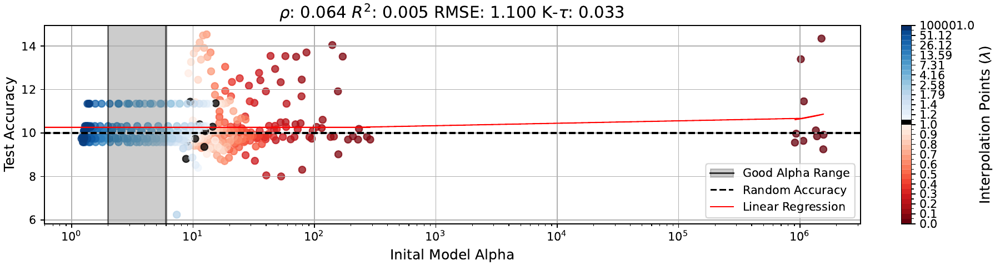
    <figcaption>Test accuracy vs model $\alpha$ at initialisation.</figcaption>
</figure>

The Figure below highlights that through training the $\alpha$ value decreases from its initial value, towards the optimal value, if the initial $\alpha$ value is large enough ($\alpha<3$ did not improve in performance during training.).  


<figure markdown>
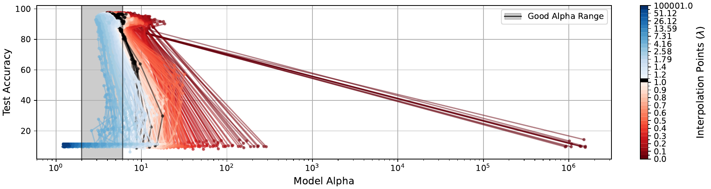
    <figcaption>Test accuracy vs model $\alpha$ through training.</figcaption>
</figure>

The Figure below highlights shows that there is a strong correlation between the initial model $\alpha$ and the resulting model $\alpha$ at the end of training. We therefore suggest that model $\alpha$ is as a consequence of our standard initialisation procedures and regularisation from SGD, not because this metric is indicative of generalisation.  

<figure markdown markdown>
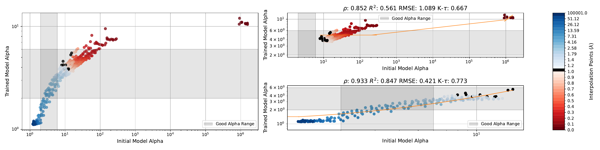
    <figcaption>**Left**: Trained model $\alpha$ vs initial model $\alpha$. <br/> **Top Right**: Interpolatation range: $0.1\leq\lambda\leq1$. <br/> **Bottom Right**: Interpolatation range: $1\leq\lambda\leq100001$</figcaption>
</figure>

### Fixed Alpha and Generalisation

We sample from the random initialisation for each layer to obtain singular values that correspond to a desired $\alpha$ value, $\Sigma_{\alpha}$, and then construct $W_{\alpha} = U\Sigma_{\alpha}V^T$ at each layer and keep $\Sigma_{\alpha}$ fixed throughout training. We then solely train $U$ and $V^T$ while maintaining the unitary properties. The Figure below shows that regardless of fixed $\alpha$ value throughout training the model can still generalise, highlighting that a "optimal" $\alpha$ value is not required for generalisation. 

<figure markdown>
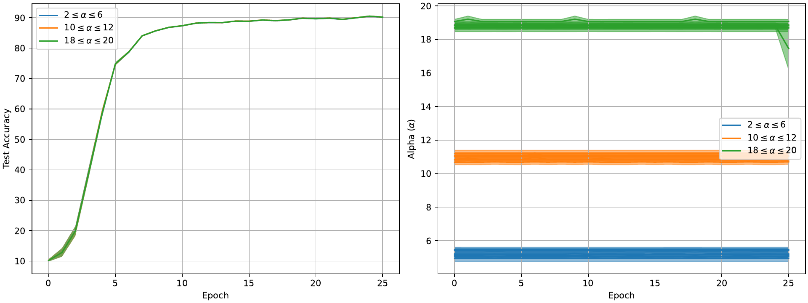
    <figcaption> **Left**: Test Accuracy through training with fixed Alpha ($\alpha$) on MNIST. **Right**: $\alpha$ value of layers thought training.</figcaption>
</figure>


## Conclusion

<div align="center" markdown>
good model $\nRightarrow$ good data-free metrics
<br/>
and
<br/>
good data-free metrics $\nRightarrow$ good model.
</div>
1. Data-free metrics have spurious relations with model performance.
2. Data-free metrics cannot meaningfully capture performance differences offered by re-initialisation and re-randomisation.
3. Pursue the understanding of neural networks with metrics that consider the crucial interplay between weights and data.
4. Prioritise data-based approaches for interpretability due to their capability of capturing the meaningful differences between re-initialisation and re-randomisation.


## BibTeX

If you find paper useful for your work please cite:


```
@inproceedings{mason-williams2026datafree,
    title={{Data-Free Metrics Don't Work: The Missing Invariance  Under Functionally Preserving Reparameterisations}},
    author={Gabryel, Mason-Williams and Israel, Mason-Williams and Fredrik, Dahlqvist},
    booktitle={The Fortieth Annual Conference on Neural Information Processing Systems},
    year={2026},
    url={https://openreview.net/forum?id=PQie2dx3oX}
}
```
